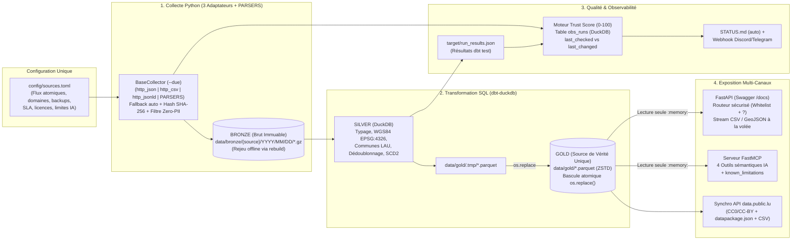

# OpenLux Hub — Blueprint d'Ingénierie & Spécification Maîtresse (v2)

> **Mission** : Construire la plateforme open source et open data la plus complète, fiable et transparente sur le Luxembourg (20 domaines : météo, trafic, frontières, chantiers, transports, culture, marchés, grèves, énergie, vie citoyenne…), accessible en **API REST (Swagger)**, **Serveur MCP (IA)**, **CSV/Parquet/GeoJSON** et publiée sur **`data.public.lu`**.
>
> **Principe Directeur** : *Moins il y a de code, plus c'est fiable, lisible et maintenable.* Chaque ligne de code est une dette future ; chaque configuration déclarative, contrat de schéma ou requête SQL lisible est un actif durable.

---

## 1. Manifeste d'Ingénierie (Standards Senior)

Ce projet applique une discipline stricte inspirée des meilleurs dépôts open source minimalistes :

1. **Data-Driven & Flux Atomiques** : On n'écrit **pas** 20 scripts de collecte différents. Les flux sont déclarés dans un seul fichier **`config/sources.toml`** (lu nativement via `tomllib` de Python 3.12) selon la règle **1 entrée = 1 flux HTTP atomique**, regroupés par `domain`. Ils sont exécutés par **3 adaptateurs génériques** (`http_json`, `http_csv`, `http_jsonld`) complétés par un registre léger `PARSERS` de fonctions pures ($\le 30$ lignes) pour les formats complexes (XML DATEX II, RSS filtré).
2. **Budget de Code Strict** : L'ensemble du cœur Python (collecte, qualité, RGPD, API, MCP, alertes, publication `data.public.lu`) doit rester **sous les 1 500 lignes de code** (cible idéale : $< 1\,200$ lignes). Toute fonction dépassant 40 lignes ou tout fichier dépassant 200 lignes doit être justifié ou simplifié.
3. **Boring Technology & 7 Dépendances Verrouillées** : 4 outils, exactement **7 bibliothèques Python runtime** verrouillées dans `pyproject.toml`, et la bibliothèque standard Python partout ailleurs (`tomllib`, `gzip`, `hashlib`, `re`, `xml.etree.ElementTree`, `logging`, `pathlib`, `dataclasses`, `os`, `uuid`). Aucune dépendance ne peut être ajoutée sans un ADR validé.
4. **Séparation Lecture / Écriture Sans Verrou & Écriture Atomique** : DuckDB exécute les transformations en batch puis exporte la couche **Gold** uniquement en fichiers **Parquet compressés (`ZSTD`)** via un répertoire temporaire (`data/gold/.tmp/`) suivi d'un basculement atomique `os.replace()`. FastAPI et FastMCP lisent uniquement ces Parquet en mémoire (`:memory:`) : zéro verrou, zéro lecture de fichier partiel, migration triviale vers un VPS ou S3.
5. **Zero-PII & Factual-Only by Design** : Aucune donnée personnelle (email, téléphone, nom d'individu) ne survit jusqu'aux couches Bronze/Silver/Gold. Le filtrage s'exécute récursivement sur les valeurs texte *avant* écriture Bronze. Pour la presse et les agendas culturels, seuls les faits bruts non protégeables sont conservés (`title` $\le 140$ caractères, zéro texte éditorial).
6. **Reproductibilité & Transparence Totale** : La couche Bronze immuable permet un rejeu 100 % hors-ligne (`openlux rebuild`). Chaque décision d'architecture ou d'arbitrage quotidien est tracée dans `docs/ARCHITECTURE.md`, `docs/adr/` ou `docs/DECISIONS_LOG.md`.

---

## 2. Règles Opérationnelles pour l'Agent IA (Antigravity)

> **Source de vérité unique** : L'ensemble des instructions impératives pour Antigravity (règles anti-sur-ingénierie, conventions de commentaires, tests offline, protocole de checkpoints et garde-fous sécurité) est isolé dans **`AGENTS.md`** à la racine du dépôt afin d'être chargé automatiquement à chaque session.

En résumé, toute contribution (humaine ou IA) respecte 5 invariants :
- Lire `AGENTS.md` avant toute modification.
- Ne jamais ajouter de dépendance hors des 7 bibliothèques runtime sans ADR.
- Écrire des tests 100 % hors-ligne (`tests/fixtures/` + `httpx.MockTransport`).
- Maintenir `docs/ARCHITECTURE.md` et `docs/DECISIONS_LOG.md` dans le même commit.
- Respecter les Checkpoints (Section 7) et attendre validation humaine entre chaque phase.

---

## 3. Architecture Cible (Socle initial de `docs/ARCHITECTURE.md`)

> *Ce schéma et ces choix constituent la version v1.0 de `docs/ARCHITECTURE.md`, maintenue à jour en continu avec le code.*

### 3.1 Flux de Données de Bout en Bout



### 3.2 Stack Verrouillée : 4 Outils, 7 Bibliothèques Runtime

| Outil | Rôle unique |
| :--- | :--- |
| **Python 3.12 + `uv`** | Runtime (`tomllib` natif), packaging déterministe (`uv.lock`) et CLI unifiée |
| **DuckDB** (+ ext. `spatial`) | Moteur SQL analytique, géospatial (LUREF $\rightarrow$ WGS84, rayons, GeoJSON), export Parquet ZSTD |
| **dbt-duckdb** | Couches Silver/Gold en SQL déclaratif, snapshots SCD2, tests de qualité, Data Catalog & Lineage (`dbt docs`) |
| **Git & GitHub** | Versioning, ADR, `DECISIONS_LOG.md`, `STATUS.md`, CI gratuite (GitHub Actions : `ruff`, `pytest`, `dbt test`) |

| # | Bibliothèque Runtime (`pyproject.toml`) | Usage exclusif |
| :-: | :--- | :--- |
| 1 | `httpx` | Appels HTTP/API, téléchargements, webhooks alertes, publication `data.public.lu`, `MockTransport` en tests |
| 2 | `pydantic` | Validation `sources.toml`, contrats de réponses API (`_meta`), modèles qualité |
| 3 | `duckdb` | Moteur analytique local, lecture `:memory:` des Parquet Gold, streaming CSV/GeoJSON |
| 4 | `dbt-duckdb` | Transformations SQL Silver $\rightarrow$ Gold, tests qualité (`run_results.json`) et documentation |
| 5 | `beautifulsoup4` | Extraction ciblée de balises `<script type="application/ld+json">` et HTML minimal |
| 6 | `fastapi` (+ `uvicorn`) | API REST, Swagger `/docs` auto-généré, téléchargement Parquet et streaming CSV/GeoJSON |
| 7 | `fastmcp` | Serveur MCP standardisé branché sur les fichiers Parquet Gold |
| *(dev)* | `pytest`, `ruff` | Tests unitaires/contrats offline, lint et formatage strict |

### 3.3 Interface CLI Officielle (`src/openlux/cli.py`)

Une seule interface CLI unifiée, sans orchestrateur externe :

| Commande | Rôle |
| :--- | :--- |
| `uv run openlux run --due` | Exécute uniquement les sources dont `now - last_checked_utc >= cadence_minutes` (idéal cron / GitHub Actions toutes les 15 min) |
| `uv run openlux run --sources a,b` | Force la collecte + transformation + Trust Score sur un sous-ensemble ciblé |
| `uv run openlux rebuild` | Rejoue 100 % hors-ligne Silver $\rightarrow$ Gold $\rightarrow$ Trust Score depuis la couche Bronze locale |
| `uv run openlux compact` | Compacte les anciens `.gz` Bronze dépassant `retention_days` en archives Parquet mensuelles |
| `uv run openlux status` | Affiche le tableau de santé dans le terminal et regénère `STATUS.md` |
| `uv run openlux serve` | Démarre l'API FastAPI (`uvicorn`) en lecture seule sur `data/gold/*.parquet` |
| `uv run openlux mcp` | Démarre le serveur FastMCP en lecture seule sur `data/gold/*.parquet` |
| `uv run openlux publish --dry-run` | Génère `datapackage.json` + CSV temporaires et valide la synchro `data.public.lu` sans publier |

### 3.4 Arborescence Minimale du Dépôt

```text
openlux-hub/
├── AGENTS.md                       # Règles opérationnelles impératives pour Antigravity
├── OPENLUX_BLUEPRINT.md            # Ce fichier maître (spécification de référence)
├── config/
│   └── sources.toml                # Source de vérité unique des flux atomiques (20 domaines)
├── data/                           # Ignoré par Git (.gitignore), généré localement
│   ├── bronze/                     # Brut immuable compressé (.json.gz / .csv.gz) + archives mensuelles
│   ├── gold/                       # Produits finaux UNIQUEMENT en .parquet (ZSTD)
│   │   └── .tmp/                   # Zone d'écriture avant bascule atomique os.replace()
│   └── openlux.duckdb              # Base Silver + table obs_runs
├── dbt_project/
│   ├── dbt_project.yml
│   ├── profiles.yml                # Connexion DuckDB locale + chargement extension spatial
│   ├── seeds/
│   │   ├── ref_communes_lu.csv     # Référentiel officiel des 100 communes + cantons + codes LAU
│   │   └── ref_recurring_events.csv# Marchés hebdomadaires & fêtes récurrentes (fallback)
│   ├── models/
│   │   ├── staging/                # Lecture directe data/bronze/*.gz via read_json_auto/read_csv
│   │   ├── silver/                 # Standardisation UTC, WGS84, communes LAU, entity resolution
│   │   └── gold/                   # Data Marts finaux + gold_luxembourg_daily_context
│   └── tests/                      # Tests SQL métier + assert_no_pii_in_gold.sql
├── docs/
│   ├── ARCHITECTURE.md             # Document vivant (TOUJOURS synchronisé avec le code)
│   ├── DECISIONS_LOG.md            # Journal léger des petits arbitrages techniques quotidiens
│   ├── GOVERNANCE_GDPR.md          # Conformité RGPD, matrice licences, scraping éthique, takedown
│   ├── DATA_CATALOG.md             # Résumé lisible des tables Gold, biais/limites & liens dbt docs
│   ├── CONTRIBUTING.md             # "Ajouter une source en 15 min via sources.toml"
│   └── adr/
│       ├── 000-template.md
│       ├── 001-duckdb-parquet-vs-postgres-iceberg.md
│       ├── 002-config-driven-collectors-and-toml.md
│       ├── 003-trust-score-methodology.md
│       └── 004-gdpr-zero-pii-and-licenses.md
├── src/openlux/
│   ├── __init__.py
│   ├── config.py                   # Chargement tomllib + validation Pydantic de sources.toml
│   ├── core/
│   │   ├── collector.py            # BaseCollector + 3 adaptateurs + fallback + SHA-256 (~170 lignes)
│   │   ├── parsers.py              # Registre PARSERS : fonctions pures <= 30 lignes (DATEX II, RSS...)
│   │   ├── sanitizer.py            # Filtre Zero-PII récursif (valeurs texte) + Factual-Only (~70 lignes)
│   │   ├── quality.py              # Trust Score + lecture run_results.json + obs_runs (~120 lignes)
│   │   └── monitoring.py           # Génération STATUS.md + Webhook alertes anti-spam (~90 lignes)
│   ├── api/
│   │   └── main.py                 # FastAPI générique sécurisé (REST, GeoJSON/CSV streamés, /status)
│   ├── mcp/
│   │   └── server.py               # FastMCP (4 outils sémantiques enrichis pour IA)
│   ├── publish/
│   │   └── opendata_lu.py          # Export datapackage.json + CSV temporaires + sync data.public.lu
│   └── cli.py                      # Interface CLI unique (`uv run openlux ...`)
├── tests/
│   ├── fixtures/                   # Échantillons réels anonymisés (JSON, CSV, DATEX II, JSON-LD)
│   ├── test_sanitizer.py           # Preuve Zero-PII (JSON/XML intacts) + troncature FACTUAL-ONLY
│   ├── test_collector_fallback.py  # Tests 100 % offline via httpx.MockTransport (fallback, UNCHANGED)
│   ├── test_trust_score.py         # Tests bornes GOOD / ATTENTION / ERROR / NOT_TESTED
│   └── test_api_contracts.py       # Vérification _meta, anti-injection SQL, streaming CSV/GeoJSON
├── notebooks/
│   ├── 01_quickstart_api_csv.ipynb # Guide étudiant / analyste / entreprise
│   └── 02_analyse_contexte_lu.ipynb# Croisement météo, trafic, fériés & événements
├── .github/workflows/ci.yml        # ruff + pytest + dbt parse + contrôle docs
├── STATUS.md                       # Généré automatiquement : santé temps réel des sources
├── CHANGELOG.md                    # Historique par version (Keep a Changelog)
├── pyproject.toml                  # Configuration uv, 7 dépendances runtime, ruff, pytest
└── README.md                       # Vitrine projet, quickstart en 3 commandes
```

---

## 4. Approche Config-Driven : `config/sources.toml` & Inventaire des 20 Domaines

### 4.1 Règle d'Atomicité & Exemple de Schéma (`config/sources.toml`)

**Règle d'or** : Une entrée `[[sources]]` correspond toujours à **un seul flux HTTP atomique** (1 primaire + 1 backup optionnel). Les flux d'un même métier partagent le champ `domain` et sont unifiés proprement en SQL dans la couche Silver/Gold. Si un fournisseur tombe (ex. Bison Futé), les autres flux du même domaine (`crossborder_traffic`) restent `GOOD`.

```toml
[[sources]]
id = "meteo_lux_obs"
domain = "weather"
description = "Observations et prévisions météo officielles au Luxembourg"
semantic_summary = "Températures, précipitations et vent relevés au Grand-Duché (Findel et stations nationales)."
known_limitations = "Couverture concentrée sur les stations principales ; microclimats locaux (vallée de la Moselle, Oesling) lissés."
adapter = "http_json"
cadence_minutes = 30
sla_minutes = 90
retention_days = 90
license_spdx = "CC0-1.0"
commercial_use_safe = true
publish_opendata_lu = true
factual_only = false

[sources.primary]
url = "https://metapi.ana.lu/api/v1/metdata/weather"
headers = { User-Agent = "OpenLuxHub/1.0 (+https://github.com/OWNER/openlux-hub)" }
# auth_env_var = "METEOLUX_API_KEY"  # Optionnel : si absent en local -> NOT_TESTED ou bascule backup

[sources.backup]
adapter = "http_json"
url = "https://api.open-meteo.com/v1/forecast?latitude=49.6117&longitude=6.1319&current=temperature_2m,precipitation,wind_speed_10m"

[sources.quality]
min_rows = 1
required_fields = ["timestamp", "temperature"]
```

### 4.2 Les 3 Adaptateurs Génériques + Registre `PARSERS`

1. **`http_json`** (`core/collector.py`) : Télécharge un payload JSON (REST, ArcGIS FeatureServer, SDMX JSON, `data.public.lu`), applique le filtre récursif `Zero-PII` sur les valeurs chaînes, calcule le hash SHA-256 (si identique au run précédent, enregistre `UNCHANGED` dans `obs_runs` sans réécrire de fichier), puis archive en `.json.gz`.
2. **`http_csv`** (`core/collector.py`) : Télécharge un CSV officiel, normalise en UTF-8, applique le filtre `Zero-PII` cellule par cellule, vérifie le hash SHA-256 et archive en `.csv.gz`.
3. **`http_jsonld`** (`core/collector.py`) : Télécharge une page d'agenda public (respect strict du `robots.txt` et délai $\ge 1\,\text{s}$ par domaine), extrait exclusivement les blocs `<script type="application/ld+json">` (`schema.org/Event`), applique la liste blanche `FACTUAL-ONLY` (`title` $\le 140$ caractères, `start_date`, `end_date`, `venue`, `city`, `source_url`) et archive en `.json.gz`.
4. **Registre `PARSERS`** (`core/parsers.py`) : Pour les formats structurés non tabulaires (XML `CITA DATEX II`, flux RSS filtrés multilingues FR/DE/EN/LB, iCal), `sources.toml` déclare `adapter = "http_custom"` + `parser = "cita_datex2"`. Chaque parser est une **fonction pure** `def parse_*(raw: bytes) -> list[dict]:` ($\le 30$ lignes, sans I/O), testée unitairement sur fixture locale.

### 4.3 Inventaire Complet des 20 Domaines (Flux Atomiques + Backup)

| # | `domain` (`source_id` atomiques) | Données couvertes | Adaptateur / Parser | Source Primaire | Source Backup (Fallback) | SLA | Licence / Statut |
| :-: | :--- | :--- | :--- | :--- | :--- | :--- | :--- |
| **1** | `weather` (`meteo_lux_obs`, `meteo_lux_alerts`) | Météo, prévisions & vigilances | `http_json`, `http_csv` | MeteoLux API + CSV alertes `data.public.lu` | Open-Meteo API (lat/lon LU) | 90 min | `CC0-1.0` / Pro OK |
| **2** | `air_quality` (`air_quality_lu`) | $\text{NO}_2$, $\text{O}_3$, PM10, PM2.5, pics pollution | `http_json` | Admin. Environnement (`data.public.lu`) | OpenAQ / WAQI API | 2 h | `CC0-1.0` / Pro OK |
| **3** | `water_levels` (`water_levels_lu`) | Niveaux rivières (Alzette, Moselle, Sûre) & crues | `http_json` | Admin. Gestion de l'Eau (`data.public.lu`) | Géoportail.lu WFS | 90 min | `CC0-1.0` / Pro OK |
| **4** | `traffic_cita` (`traffic_cita_datex2`) | Bouchons, accidents, temps de parcours autoroutes | `parser: cita_datex2` | CITA Flux XML **DATEX II** | TomTom Traffic API (`TOMTOM_API_KEY`) | 30 min | `CC0-1.0` / Pro OK |
| **5** | `crossborder_traffic` (`traffic_de_autobahn`, `traffic_fr_bisonfute`, `traffic_be_trafiroutes`, `rail_crossborder`) | Axes frontaliers A31 (FR), E411 (BE), A64 (DE) & trains | `http_json`, `parser: xml_datex2` | Autobahn.de, Bison Futé, Trafiroutes, SNCF/iRail | TomTom Traffic API | 45 min | `Open-EU` / Pro OK |
| **6** | `roadworks` (`roadworks_cita`, `roadworks_vdl`) | Chantiers nationaux & travaux communaux VDL | `parser: cita_datex2`, `http_json` | CITA DATEX II + VDL ArcGIS REST | Parsing factuel `travaux.vdl.lu` | 36 h | `CC0-1.0` / Faits |
| **7** | `housing_construction` (`housing_observatoire`, `housing_statec`) | Prix $\text{m}^2$, loyers, projets PAG/PAP | `http_csv`, `http_json` | Observatoire Habitat (`data.public.lu`) + Géoportail | STATEC SDMX API | 100 j | `CC0-1.0` / Pro OK |
| **8** | `public_transit` (`transit_mobiliteit`, `transit_avl_rt`) | Horaires & retards CFL, AVL, RGTR, Tram | `http_json` | API Mobiliteit.lu (HAFAS) + AVL RT | GTFS statique (`data.public.lu`) | 15 min | `CC-BY-4.0` / Pro OK |
| **9** | `mobility_parkings` (`veloh_stations`, `parkings_vdl`, `chargy_stations`) | Vel'oH, parkings VDL, P+R CFL, bornes Chargy | `http_json` | JCDecaux API + datasets `data.public.lu` | GBFS Vel'oH + OpenChargeMap | 30 min | `CC0-1.0` / Pro OK |
| **10** | `concerts_culture` (`culture_echo_lu`, `culture_venues_jsonld`) | Concerts, expos, festivals (Rockhal, Atelier, Philharmonie…) | `http_jsonld` | JSON-LD (`schema.org/Event`) salles + Echo.lu | Ticketmaster Discovery API (`LU`) | 36 h | `FACTUAL-ONLY` (URL) |
| **11** | `local_events_markets` (`events_vdl`, `events_visitlu`) | Agenda VDL, marchés hebdo, Schueberfouer, Noël | `http_json`, `http_jsonld` | VDL ArcGIS + VisitLuxembourg | Seed CSV `ref_recurring_events` | 36 h | `FACTUAL-ONLY` (URL) |
| **12** | `major_venues` (`venues_luxexpo`, `venues_stade_coque`) | Salons Luxexpo, matchs Stade de LU, Coque | `http_jsonld`, `parser: ical` | JSON-LD / iCal des 3 agendas | Flux RSS événements | 36 h | `FACTUAL-ONLY` (URL) |
| **13** | `holidays_vacations` (`holidays_lu`, `school_vacations_lu`) | Jours fériés légaux + vacances scolaires (4 langues) | `http_csv`, `http_json` | `data.public.lu` (datasets officiels) | Nager.Date API (`LU`) | 35 j | `CC0-1.0` / Pro OK |
| **14** | `strikes_disruptions` (`strikes_rss_lu`) | Préavis grèves transports / public, manifs majeures | `parser: strikes_rss` | RSS `rtl.lu`, `lessentiel.lu`, `ogbl.lu`, `lcgb.lu` (FR/DE/EN/LB) | Google News RSS (`grève OR Streik Luxembourg`) | 4 h | `FACTUAL-ONLY` (URL) |
| **15** | `economy_fuel` (`fuel_prices_lu`, `statec_inflation`) | Prix max essence/diesel, inflation, tranche indiciaire | `http_csv`, `http_json` | STATEC SDMX + prix carburants `data.public.lu` | Weekly Oil Bulletin UE / Eurostat | 36 h | `CC0-1.0` / Pro OK |
| **16** | `health_pollen_alerts` (`pollen_lu`, `aed_defib_lu`, `lu_alert`) | Pollens, défibrillateurs (AED), LU-Alert, pharmacies | `http_json`, `http_csv` | `pollen.lu`, `data.public.lu` (AED), flux LU-Alert | Open-Meteo Pollen API | 36 h | `CC0-1.0` / Public |
| **17** | `civic_life` (`petitions_chd`, `unemployment_adem`) | Pétitions publiques (seuil 4 500), chômage ADEM | `http_jsonld`, `http_csv` | Parsing factuel `petitiounen.lu` + ADEM `data.public.lu` | Flux RSS `chd.lu` | 36 h | `Public-LU` |
| **18** | `aviation_noise` (`aviation_opensky_lu`, `noise_zones_lu`) | Trafic aéroport Findel (LUX) & zones de bruit | `http_json` | OpenSky Network API (bbox LU) + Géoportail | ADSB.lol API | 45 min | `Open` / `CC0-1.0` |
| **19** | `energy_climate` (`electricity_spot_delu`, `radioactivity_lu`, `bathing_water_lu`) | Prix spot élec DE-LU, radioactivité, eaux baignade | `http_json`, `http_csv` | ENTSO-E API + `data.public.lu` | Energy-Charts API | 3 h | `CC0-1.0` / Pro OK |
| **20** | `daily_life_sport` (`bike_lanes_lu`, `open_sundays_vdl`, `recycling_centers`) | Pistes cyclables PC1–PC32, dimanches ouverts, déchetteries | `http_json` | Géoportail.lu + VDL Open Data + OSM Overpass | Seed CSV communautaire versionné | 35 j | `ODbL` / `CC0-1.0` |

---

## 5. Qualité (Trust Score), Traçabilité MLOps, Contrats API/MCP & Monitoring

### 5.1 Formule du Trust Score (0 à 100) et Distinction Fraîcheur / Mutation

Calculé automatiquement à chaque exécution dans `core/quality.py` et stocké dans `obs_runs` (DuckDB) :

$$\text{Trust Score} = 0.35 \cdot S_{\text{fraîcheur}} + 0.25 \cdot S_{\text{complétude}} + 0.20 \cdot S_{\text{validité}} + 0.20 \cdot S_{\text{source}}$$

- **$S_{\text{fraîcheur}}$ (35 %)** : calculé sur **`last_checked_utc`** (et non sur `last_changed_utc`, afin qu'une source stable renvoyant `UNCHANGED` via SHA-256 reste à 100). Vaut `100` si $\text{âge} \le \text{SLA}$, puis décroissance linéaire jusqu'à `0` à $3 \times \text{SLA}$.
- **$S_{\text{complétude}}$ (25 %)** : taux de présence des `required_fields`, pondéré par la stabilité volumétrique (pénalité si chute de volume $> 50\,\%$ par rapport à la médiane sur 7 jours).
- **$S_{\text{validité}}$ (20 %)** : pourcentage de tests réussis lu **directement depuis `dbt_project/target/run_results.json`** combiné aux validations Pydantic (zéro duplication de logique qualité).
- **$S_{\text{source}}$ (20 %)** : `100` si source primaire officielle ; `80` si bascule backup active ; `70` si extraction web/RSS factuelle non corroborée.

| État | Score | Comportement système |
| :--- | :---: | :--- |
| `GOOD` | $85 - 100$ | Nominal. Pastille verte dans `STATUS.md`. |
| `ATTENTION` | $60 - 84$ | Backup actif, léger retard SLA ou champs secondaires manquants. Alerte si $> 3$ runs consécutifs. |
| `ERROR` | $< 60$ | Échec primaire + backup, volume nul ou schéma cassé. **Webhook alerte immédiat**. L'API sert la dernière donnée Gold valide avec `is_stale: true`. |
| `NOT_TESTED` | N/A | Source en cours d'intégration, désactivée volontairement, ou `auth_env_var` absente en environnement local. |

### 5.2 Contrat Gold Standard & Périmètre de `gold_luxembourg_daily_context`

1. **Colonnes standard obligatoires sur toute table Gold** (lorsque pertinent) : `observed_at_utc` (`TIMESTAMP`), `commune_lau` (`VARCHAR`), `lat` (`DOUBLE`), `lon` (`DOUBLE`), `source_id` (`VARCHAR`).
2. **Périmètre ciblé de `gold_luxembourg_daily_context`** : Pour éviter les tables clairsemées mêlant grains trimestriels et temps réel, cette vue consolidée (grain : `date × commune_lau`) croise exclusivement les **8 signaux véritablement journaliers** : météo, qualité de l'air, jours fériés/vacances scolaires, état trafic autoroutier/frontalier, chantiers actifs, préavis de grèves, niveaux d'eau/vigilances et événements majeurs. Les autres domaines (immobilier, pistes cyclables, pétitions…) restent exposés dans leurs tables Gold dédiées.

### 5.3 Contrat de Métadonnées Obligatoire (`_meta`) — Traçabilité MLOps & IA

Toute réponse FastAPI et tout retour d'outil FastMCP inclut cette enveloppe :

```json
{
  "_meta": {
    "dataset": "traffic_cita",
    "trust_score": 94.5,
    "status": "GOOD",
    "is_stale": false,
    "last_checked_utc": "2026-11-20T22:10:00Z",
    "last_changed_utc": "2026-11-20T21:55:00Z",
    "source_used": "primary",
    "source_url": "https://www.cita.lu/",
    "license_spdx": "CC0-1.0",
    "commercial_use_safe": true,
    "known_limitations": "Couvre le réseau autoroutier national ; ne couvre pas les rues communales.",
    "run_id": "7f3c9b12-4a8e-4c1b-9c22-8f6a1d4e2a10",
    "pipeline_git_sha": "a1b2c3d",
    "row_count": 42
  },
  "data": []
}
```

### 5.4 API REST Minimaliste & Sécurisée (`src/openlux/api/main.py` — $< 160$ lignes)

Un seul routeur générique piloté par le registre des fichiers `data/gold/*.parquet` :
- **Sécurité anti-injection SQL** : `{dataset}` est obligatoirement validé contre une **whitelist stricte** dérivée du registre Gold ; tous les filtres (`commune`, `date_from`, `date_to`, `lat`, `lon`, `radius_km`, `limit`, `offset`) sont transmis via des **paramètres liés (`?`)** à DuckDB, jamais interpolés dans une chaîne SQL.
- **Endpoints** :
  - `GET /v1/status` : santé globale, Trust Scores, `last_checked_utc` et `last_changed_utc`.
  - `GET /v1/datasets` : catalogue dynamique (description, `semantic_summary`, `known_limitations`, schéma, licence, volume).
  - `GET /v1/data/{dataset}` : filtrage générique + géospatial (via DuckDB `spatial`) + bloc `_meta`.
  - `GET /v1/exports/{dataset}.parquet` : téléchargement direct du fichier ZSTD.
  - `GET /v1/exports/{dataset}.csv` et `.geojson` : **streamés à la volée** depuis DuckDB (zéro duplication `.csv` sur disque).
  - `GET /docs` et `/redoc` : documentation OpenAPI 3.1 auto-générée.

### 5.5 Serveur MCP Orienté Usage (`src/openlux/mcp/server.py` — $< 130$ lignes)

Expose **4 outils sémantiques** à haute valeur ajoutée, retournant systématiquement `_meta` (incluant `trust_score`, `is_stale` et `known_limitations` pour prévenir les hallucinations IA) :
1. `get_platform_health(domain: str | None)` : état de fraîcheur, Trust Score et anomalies par source/domaine.
2. `get_luxembourg_day_context(date: str, commune: str = "Luxembourg")` : interroge `gold_luxembourg_daily_context` (les 8 signaux journaliers unifiés).
3. `search_luxembourg_events_and_works(query: str, date_from: str, date_to: str, lat: float | None, lon: float | None, radius_km: float = 10.0)` : recherche croisée événements, concerts, marchés, chantiers et perturbations.
4. `query_dataset(dataset: str, commune: str | None, limit: int = 50)` : accès structuré à n'importe quelle table Gold autorisée.

### 5.6 Monitoring Zéro-Infra (`core/monitoring.py`)

À chaque exécution (`openlux run`), le module :
1. Enregistre le run dans `obs_runs` (`run_id`, `pipeline_git_sha`, `run_outcome`, `last_checked_utc`, `last_changed_utc`, `trust_score`).
2. Regénère **`STATUS.md`** à la racine du dépôt (Domaine | Source | État | Trust Score | Source active | Lignes | Dernier contrôle | Dernière mutation | Licence).
3. Envoie un message JSON concis sur `OPENLUX_ALERT_WEBHOOK_URL` (Discord/Telegram) uniquement lors d'une **transition vers `ERROR`** ou après **3 `ATTENTION` consécutifs** (anti-spam).

---

## 6. Gouvernance, RGPD, Scraping Éthique & Publication `data.public.lu`

### 6.1 Règles RGPD (« Zero-PII by Design »)

1. **Sanitizer récursif avant stockage Bronze (`core/sanitizer.py`)** : parcourt uniquement les *valeurs chaînes* (JSON/CSV) et *nœuds texte* (XML) afin de ne jamais corrompre la syntaxe ni les identifiants numériques. Remplace les emails (`[REDACTED_EMAIL]`) et téléphones explicitement formatés (`+352...`, `00352...`, ou séparateurs standards $\rightarrow$ `[REDACTED_PHONE]`).
2. **Schémas Silver/Gold fermés** : aucun modèle dbt n'autorise de colonne `email`, `phone`, `contact_name` ou `organizer_person`. Seules les personnes morales (communes, salles, institutions) sont conservées.
3. **Tests CI bloquants** : `dbt_project/tests/assert_no_pii_in_gold.sql` scanne les colonnes texte Gold à chaque run dbt ; `tests/test_sanitizer.py` vérifie l'intégrité syntaxique et la rédaction PII.
4. **Logs anonymisés** : FastAPI ne logue ni adresse IP client ni paramètre sensible.
5. **Procédure de retrait (*Takedown*)** : documentée dans `docs/GOVERNANCE_GDPR.md` avec contact dédié et délai d'engagement ($< 48\,\text{h}$).

### 6.2 Scraping Éthique & Preuve Technique `FACTUAL-ONLY`

- Respect automatique de `robots.txt`, *User-Agent* explicite pointant vers le dépôt GitHub, et délai de politesse ($\ge 1\,\text{s}$ entre requêtes sur un même domaine).
- **Garantie technique `FACTUAL-ONLY`** : pour toute source marquée `factual_only = true` (presse, syndicats, agendas culturels), le sanitizer applique une **liste blanche stricte de champs** (`title`, `start_date`, `end_date`, `venue`, `city`, `category`, `source_url`), rejette tout champ éditorial (`body`, `description`, `summary`, `content`) et tronque `title` à $\le 140$ caractères. Ce contrat est vérifié automatiquement en CI.

### 6.3 Rétention Bronze & Publication `data.public.lu`

- **Compaction Bronze (`openlux compact`)** : les flux à haute fréquence (`public_transit`, `traffic_cita`) génèrent des dizaines de milliers de petits `.gz` par an. Les fichiers dépassant `retention_days` sont fusionnés mensuellement en archives Parquet ZSTD pour garder des lectures DuckDB instantanées.
- **Cloisonnement Open Data** : seul un dataset marqué `publish_opendata_lu = true` (`CC0-1.0` ou `CC-BY-4.0`) est inclus dans `openlux publish`. La commande génère `datapackage.json` (Frictionless Data) et les exports `.csv` temporaires uniquement au moment de la publication vers l'API `udata` (`https://data.public.lu/api/1/`).

---

## 7. Plan d'Exécution & Checkpoints (Roadmap Antigravity)

> **Règle d'avancement** : Ne jamais démarrer la Phase $N+1$ avant que la Definition of Done (DoD) de la Phase $N$ soit verte et validée par l'utilisateur.

### Phase 0 — Initialisation, Gouvernance & Socle Doc
- **Actions** :
  1. Initialiser `pyproject.toml` (`uv`) avec exactement les 7 bibliothèques runtime + `pytest`/`ruff` en dev.
  2. Créer l'arborescence, `.gitignore`, `.env.example`, `.github/workflows/ci.yml`, `docs/DECISIONS_LOG.md`.
  3. Rédiger les 4 ADR fondateurs (`docs/adr/001` à `004`), `docs/ARCHITECTURE.md` (v1.0), `docs/GOVERNANCE_GDPR.md` et `README.md`.
  4. Créer le seed officiel `dbt_project/seeds/ref_communes_lu.csv` (100 communes LU, cantons, codes LAU, centroïdes WGS84).
- **DoD** : `uv sync` et `uv run ruff check .` verts ; structure et docs fondatrices en place.
- **Checkpoint 0** : Validation humaine de l'architecture et des ADR.

### Phase 1 — Moteur Minimal & Vertical Slice (3 Sources Pilotes)
- **Objectif** : Prouver toute la chaîne de bout en bout avec un minimum de code sur 3 protocoles distincts : `meteo_lux_obs` (`http_json`), `traffic_cita_datex2` (`parser: cita_datex2`) et `holidays_lu` (`http_csv`).
- **Actions** :
  1. Implémenter `config.py`, `core/sanitizer.py`, `core/parsers.py` (`cita_datex2`), `core/collector.py` (3 adaptateurs + fallback + SHA-256 + `UNCHANGED`), `core/quality.py` (Trust Score + `run_results.json` + `obs_runs`), `core/monitoring.py` (`STATUS.md` + webhook), `cli.py` (`run`, `run --due`, `rebuild`, `status`).
  2. Configurer `dbt_project/` (`dbt-duckdb` + `spatial`) : modèles staging $\rightarrow$ silver $\rightarrow$ gold, écriture atomique `.tmp` $\rightarrow$ `os.replace()` en Parquet ZSTD, test `assert_no_pii_in_gold.sql`.
  3. Créer `tests/fixtures/` (échantillons réels anonymisés) et écrire les tests 100 % offline (`test_sanitizer.py`, `test_collector_fallback.py` via `httpx.MockTransport`, `test_trust_score.py`).
  4. Mettre à jour `docs/ARCHITECTURE.md`, `docs/DATA_CATALOG.md` et `docs/DECISIONS_LOG.md`.
- **DoD** :
  - `uv run openlux run --sources meteo_lux_obs,traffic_cita_datex2,holidays_lu` et `uv run openlux rebuild` réussissent de bout en bout.
  - Les tests offline prouvent : bascule backup (`ATTENTION`), payload inchangé (`UNCHANGED` avec `S_fraîcheur = 100`), rédaction Zero-PII sans casse JSON/XML, et écriture atomique Gold.
  - `uv run pytest`, `uv run ruff check .` et `dbt test` 100 % verts ; `STATUS.md` généré.
- **Checkpoint 1** : Revue de code, contrôle du budget de lignes et validation humaine.

### Phase 2 — Exposition Universelle : FastAPI (Swagger) & FastMCP
- **Actions** :
  1. Implémenter `src/openlux/api/main.py` (whitelist datasets, requêtes paramétrées `?`, filtrage géospatial DuckDB, `_meta` complet, streaming `.csv` et `.geojson`, Swagger `/docs`).
  2. Implémenter `src/openlux/mcp/server.py` (4 outils sémantiques avec `known_limitations` et `_meta`).
  3. Écrire `tests/test_api_contracts.py` (contrats `_meta`, rejet d'injection SQL, streaming CSV/GeoJSON) et mettre à jour `docs/ARCHITECTURE.md` + `README.md`.
- **DoD** : Swagger `/docs` fonctionnel, streaming `.csv`/`.geojson` valide, serveur MCP opérationnel sur les 3 sources pilotes.
- **Checkpoint 2** : Test réel de l'API et du serveur MCP par l'utilisateur.

### Phase 3 — Passage à l'Échelle : Ajout des 17 Autres Domaines (Config-Driven)
- **Règle d'or** : Chaque vague ajoute principalement des blocs atomiques dans `config/sources.toml` + des modèles SQL Silver/Gold dans `dbt_project/`. Zéro duplication Python.
- **Découpage par vagues (1 PR / 1 Checkpoint par vague)** :
  - **Vague 3A (Environnement & Énergie)** : `air_quality` (#2), `water_levels` (#3), `economy_fuel` (#15), `energy_climate` (#19).
  - **Vague 3B (Mobilité & Frontières)** : `crossborder_traffic` (#5), `public_transit` (#8), `mobility_parkings` (#9), `aviation_noise` (#18).
  - **Vague 3C (Territoire, Travaux & Quotidien)** : `roadworks` (#6), `housing_construction` (#7), `daily_life_sport` (#20).
  - **Vague 3D (Culture, Vie Locale, Santé & Grèves)** : `concerts_culture` (#10), `local_events_markets` (#11), `major_venues` (#12), `strikes_disruptions` (#14 — parser pur `strikes_rss` dans `core/parsers.py`), `health_pollen_alerts` (#16), `civic_life` (#17).
- **Consolidation Gold** : Construire `gold_luxembourg_daily_context` (les 8 signaux journaliers) et le dédoublonnage SQL multi-sources des événements.
- **DoD** : Les 20 domaines apparaissent dans `STATUS.md`, `dbt test` vert, `docs/ARCHITECTURE.md` et `docs/DATA_CATALOG.md` à jour.

### Phase 4 — Finalisation Open Source & Publication `data.public.lu`
- **Actions** :
  1. Implémenter `src/openlux/publish/opendata_lu.py` (`datapackage.json` + CSV temporaires + sync `data.public.lu`, mode `--dry-run` par défaut) et `openlux compact`.
  2. Rédiger `docs/CONTRIBUTING.md` et les 2 notebooks pédagogiques dans `notebooks/`.
  3. Configurer la publication gratuite de `dbt docs` sur GitHub Pages.
  4. Audit final : comptage des lignes Python ($< 1\,500$), vérification Zero-PII & `FACTUAL-ONLY`, cohérence documentaire complète.
- **DoD** : `uv run openlux publish --dry-run` valide les métadonnées ; CI GitHub Actions verte ; dépôt prêt à être ouvert au public.

---

## 8. Protocole de Maintenance Documentaire Continue

Pour garantir une transparence totale sur chaque choix technique et une lisibilité intacte dans 12 mois :

| Fichier | Quand le mettre à jour ? | Responsable |
| :--- | :--- | :--- |
| `docs/ARCHITECTURE.md` | À **chaque** ajout de module, flux, table Gold ou changement de schéma | Obligatoire dans le commit |
| `docs/adr/NNN-*.md` | À chaque choix structurant (format, librairie, formule, compromis majeur) | Avant ou pendant l'implémentation |
| `docs/DECISIONS_LOG.md` | À chaque petit arbitrage quotidien (seuil, filtre, contournement API) | Dans le commit concerné |
| `STATUS.md` | À chaque run du pipeline | Automatique (`core/monitoring.py`) |
| `docs/DATA_CATALOG.md` + `dbt docs` | À chaque ajout/modification de modèle Gold | Automatique (`dbt docs generate`) |
| `CHANGELOG.md` | À chaque fin de phase / vague | Fin de checkpoint |

### Template ADR (`docs/adr/000-template.md`)

```markdown
# ADR-NNN : [Titre court de la décision]

- **Statut** : Proposé | Accepté | Remplacé par ADR-XXX
- **Date** : YYYY-MM-DD

## Contexte
Quel problème concret cherchons-nous à résoudre et quelles sont nos contraintes (simplicité, maintenance, RGPD, performance) ?

## Options envisagées
1. **Option A** : avantages / inconvénients.
2. **Option B** : avantages / inconvénients.

## Décision
Option retenue et justification concise.

## Conséquences
- Positives : ...
- Compromis acceptés / Limites connues : ...
- Critère de réévaluation (quand faudra-t-il migrer ?) : ...
```

### Template Journal d'Arbitrages (`docs/DECISIONS_LOG.md`)

```markdown
# Decisions Log — Arbitrages Techniques Quotidiens

| Date | Sujet | Choix retenu | Pourquoi | Réversible ? |
| :--- | :--- | :--- | :--- | :---: |
| 2026-11-20 | Format de config | TOML (`tomllib`) au lieu de YAML | Évite `pyyaml` en runtime et reste strictement à 7 dépendances | Oui |
```

---

## 9. Backlog Priorisé (Strictement Hors-Scope V1)

> Ces évolutions ne seront activées **qu'après validation complète de la Phase 4**. Grâce au découplage strict **Parquet ZSTD + Lecture `:memory:` + CLI `--due`**, aucune ne nécessitera de réécrire le cœur du projet :

1. **Automatisation Cloud Zéro-Coût (V1.1)** : Déclenchement de `uv run openlux run --due` via GitHub Actions (cron 15 min) ou systemd timer sur un petit VPS européen, avec push automatique des Parquet Gold vers un bucket S3/R2 public (Cloudflare R2 / Scaleway) lisible directement par DuckDB HTTPFS.
2. **Conteneurisation Légère (V1.2)** : Un `Dockerfile` unique multi-stage (`uv` + Python 3.12-slim) pour déployer `openlux serve` et `openlux mcp` sur Fly.io, Coolify ou un VPS derrière Caddy (HTTPS automatique).
3. **Sécurité & Quotas API Publics (V1.3)** : Rate-limiting par clé/IP anonymisée (en-têtes `X-RateLimit-*`), cache HTTP (`ETag` basé sur le hash du Parquet Gold + `Cache-Control`) pour absorber les pics de trafic à coût quasi nul.
4. **Data Science & ML Appliqué (V2.0)** : Modèles légers de détection d'anomalies (pics de trafic frontalier, qualité de l'air, crues) et prévision court terme à partir de `gold_luxembourg_daily_context`, versionnés avec traçabilité `pipeline_git_sha` et `run_id`.
5. **Portail Web Statique & Cartes (V2.1)** : Interface statique ultra-légère (sans backend lourd) interrogeant directement les fichiers Parquet Gold publics via **DuckDB-Wasm** dans le navigateur ou via l'API `/v1/`.
6. **Format Table Ouvert (V2.2 — si volume $> 10\,\text{Go}$)** : Migration de l'archivage Parquet vers Apache Iceberg ou Delta Lake uniquement si le volume historique ou les écritures concurrentes le justifient (critère de réévaluation documenté dans `ADR-001`).