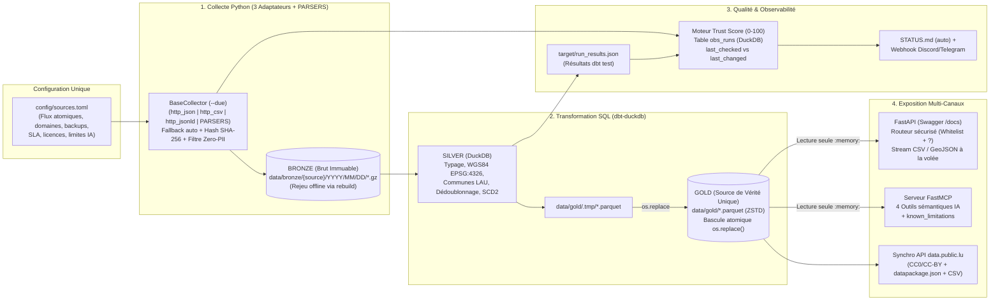

# OpenLux Hub — Architecture Technique (v1.5)

> Ce document vivant décrit l'état actuel et l'architecture cible d'OpenLux Hub.
> Il est mis à jour à chaque évolution de module, ajout de flux ou modification de schéma.

---

## 1. Vue d'Ensemble & Flux de Données



---

## 2. Découpage des Couches de Données

### 2.1 Couche Bronze (Immuable & Rejouable)
- **Format** : Fichiers bruts compressés GZIP (`.json.gz`, `.csv.gz`).
- **Chemin** : `data/bronze/{source_id}/YYYY/MM/DD/{source_id}_{timestamp_utc}_{hash8}.[json|csv].gz` et miroir `latest.[json|csv].gz`.
- **Garantie** : Sanitized Zero-PII et Factual-Only appliqués en amont de l'écriture. Les payloads inchangés (`UNCHANGED`) ne créent pas de nouveau fichier physique.
- **Rejeu** : `uv run openlux rebuild` permet de reconstruire l'intégralité des couches Silver et Gold sans aucun accès internet.

### 2.2 Couche Silver (Normalisation & Typage SQL)
- **Moteur** : DuckDB via `dbt-duckdb`.
- **Modèles** :
  - `staging` : Décompression et typage à la volée (`read_json_auto`, `read_csv`).
  - `silver` : Standardisation temporelle en UTC (`TIMESTAMP`), coordonnées projetées en WGS84 (`lat`, `lon` en EPSG:4326), jointure sur le référentiel officiel des 100 communes (`commune_lau`).

### 2.3 Couche Gold (Source de Vérité Unique)
- **Format** : Uniquement fichiers Parquet compressés **ZSTD** dans `data/gold/{nom_table}.parquet`.
- **Atomicité** : Écriture systématique dans `data/gold/.tmp/{nom_table}.parquet` puis basculement instantané via `os.replace()`.
- **Isolation Lecture/Écriture** : FastAPI et FastMCP chargent les Parquet en mémoire vive (`:memory:`) ; ils ne subissent aucun verrouillage d'écriture.

---

## 3. Stack Technique Verrouillée

| Outil / Dépendance | Usage Exclusif |
| :--- | :--- |
| **Python 3.12+ & `uv`** | Environnement, `tomllib` natif, packaging et exécution CLI |
| **`httpx`** | Téléchargements HTTP, retries, `MockTransport` pour tests offline déterministes |
| **`pydantic`** | Validation du contrat `sources.toml`, modèles qualité et métadonnées API (`_meta`) |
| **`duckdb`** (+ `spatial`) | Moteur analytique in-process, calculs spatiaux, streaming CSV/GeoJSON |
| **`dbt-duckdb`** | Transformations SQL déclaratives, tests d'intégrité, génération du catalogue de données |
| **`beautifulsoup4`** | Extraction sélective des balises schema.org/Event `<script type="application/ld+json">` |
| **`fastapi` (+ `uvicorn`)** | API REST haute performance avec documentation OpenAPI / Swagger automatique |
| **`fastmcp`** | Serveur MCP (Model Context Protocol) branché sur les Parquet Gold |
| **`pytest` & `ruff`** | Tests unitaires hors-ligne, validation statique de types, lint et formatage strict |

---

## 4. Contrat de Métadonnées MLOps (`_meta`)

Chaque appel API `/v1/data/{dataset}` et chaque outil FastMCP fournit cette enveloppe standardisée (Section 5.3 du Blueprint) :
```json
{
  "_meta": {
    "dataset": "gold_crossborder_traffic",
    "trust_score": 100.0,
    "status": "GOOD",
    "is_stale": false,
    "last_checked_utc": "2026-11-20T22:00:00Z",
    "last_changed_utc": "2026-11-20T21:00:00Z",
    "source_used": "primary",
    "source_url": "https://data.public.lu/fr/datasets/r/traffic-fr-a31.json",
    "license_spdx": "Open-EU",
    "commercial_use_safe": true,
    "known_limitations": "Données DIR Est / Bison Futé indicatives...",
    "run_id": "uuid-v4",
    "pipeline_git_sha": "git_v1",
    "row_count": 6
  },
  "data": []
}
```

---

## 5. Modules Cœur Implémentés (Phase 3 — Échelle Complète : 20 Domaines)

| Module | Rôle & Responsabilité Unique | Lignes |
| :--- | :--- | :---: |
| `src/openlux/config.py` | Chargement natif `tomllib` et validation Pydantic de `config/sources.toml` | 79 |
| `src/openlux/core/sanitizer.py` | Filtrage récursif Zero-PII (emails, téléphones) et garanties Factual-Only | 66 |
| `src/openlux/core/parsers.py` | Registre `PARSERS` : fonctions pures $\le 30$ lignes (`cita_datex2`, `strikes_rss`) | 86 |
| `src/openlux/core/collector.py` | Moteur de collecte unifié (3 adaptateurs + custom, fallback, SHA-256, Bronze) | 196 |
| `src/openlux/core/quality.py` | Calcul du Trust Score (0-100), traçabilité MLOps et table `obs_runs` (DuckDB) | 190 |
| `src/openlux/core/monitoring.py` | Régénération de `STATUS.md` et webhook alertes anti-spam | 113 |
| `src/openlux/core/gold.py` | Exportation atomique `.tmp` $\rightarrow$ `os.replace()`, whitelist et requêtes spatiales | 198 |
| `src/openlux/api/main.py` | API REST FastAPI : Swagger, whitelist, DuckDB in-memory, stream CSV/GeoJSON | 193 |
| `src/openlux/mcp/server.py` | Serveur FastMCP : 4 outils sémantiques IA connectés aux Data Marts Gold | 168 |
| `src/openlux/cli.py` | CLI unifiée (`openlux run`, `rebuild`, `status`, `compact`, `serve`, `mcp`) | 194 |
| **Total Cœur Python** | **Budget strict $< 1\,500$ lignes (cible $< 1\,200$)** | **1 493** |

---

## 6. Domaines et Data Marts Actifs (40 Sources, 20 Domaines, 22 Tables Gold)

| # | Domaine | Sources Atomiques Incluses | Table Gold Produite | Format & Moteur |
| :-: | :--- | :--- | :--- | :--- |
| **1** | `weather` | `meteo_lux_obs` | `gold_weather_observations.parquet` | Parquet ZSTD (dbt DuckDB) |
| **2** | `traffic_cita` | `traffic_cita_datex2` | `gold_traffic_events.parquet` | Parquet ZSTD (dbt DuckDB) |
| **3** | `holidays_vacations` | `holidays_lu` | `gold_holidays.parquet` | Parquet ZSTD (dbt DuckDB) |
| **4** | `air_quality` (3A) | `air_quality_lu` | `gold_air_quality.parquet` | Parquet ZSTD (dbt DuckDB) |
| **5** | `water_levels` (3A) | `water_levels_lu` | `gold_water_levels.parquet` | Parquet ZSTD (dbt DuckDB) |
| **6** | `economy_fuel` (3A) | `fuel_prices_lu`, `statec_inflation` | `gold_fuel_prices.parquet`, `gold_statec_inflation.parquet` | Parquet ZSTD (dbt DuckDB) |
| **7** | `energy_climate` (3A) | `electricity_spot_delu`, `radioactivity_lu`, `bathing_water_lu` | `gold_electricity_spot.parquet`, `gold_radioactivity.parquet`, `gold_bathing_water.parquet` | Parquet ZSTD (dbt DuckDB) |
| **8** | `crossborder_traffic` (3B) | `traffic_fr_bisonfute`, `traffic_de_autobahn`, `traffic_be_trafiroutes`, `rail_crossborder` | `gold_crossborder_traffic.parquet` | Parquet ZSTD (dbt DuckDB) |
| **9** | `public_transit` (3B) | `transit_mobiliteit`, `transit_avl_rt` | `gold_public_transit.parquet` | Parquet ZSTD (dbt DuckDB) |
| **10** | `mobility_parkings` (3B) | `veloh_stations`, `parkings_vdl`, `chargy_stations` | `gold_mobility_parkings.parquet` | Parquet ZSTD (dbt DuckDB) |
| **11** | `aviation_noise` (3B) | `aviation_opensky_lu`, `noise_zones_lu` | `gold_aviation_noise.parquet` | Parquet ZSTD (dbt DuckDB) |
| **12** | `roadworks` (3C) | `roadworks_cita`, `roadworks_vdl` | `gold_roadworks.parquet` | Parquet ZSTD (dbt DuckDB) |
| **13** | `housing_construction` (3C) | `housing_observatoire`, `housing_statec` | `gold_housing.parquet` | Parquet ZSTD (dbt DuckDB) |
| **14** | `daily_life_sport` (3C) | `bike_lanes_lu`, `open_sundays_vdl`, `recycling_centers` | `gold_daily_life.parquet` | Parquet ZSTD (dbt DuckDB) |
| **15** | `concerts_culture` (3D) | `culture_echo_lu`, `culture_venues_jsonld` | `gold_culture_events.parquet` | Parquet ZSTD (dbt DuckDB) |
| **16** | `local_events_markets` (3D) | `events_vdl`, `events_visitlu` | *(inclus dans `gold_culture_events.parquet`)* | Parquet ZSTD (dbt DuckDB) |
| **17** | `major_venues` (3D) | `venues_luxexpo`, `venues_stade_coque` | *(inclus dans `gold_culture_events.parquet`)* | Parquet ZSTD (dbt DuckDB) |
| **18** | `strikes_disruptions` (3D) | `strikes_rss_lu` | `gold_strikes_disruptions.parquet` | Parquet ZSTD (dbt DuckDB) |
| **19** | `health_pollen_alerts` (3D) | `pollen_lu`, `aed_defib_lu`, `lu_alert` | `gold_health_alerts.parquet` | Parquet ZSTD (dbt DuckDB) |
| **20** | `civic_life` (3D) | `petitions_chd`, `unemployment_adem` | `gold_civic_life.parquet` | Parquet ZSTD (dbt DuckDB) |
| **-** | **Consolidation Globale** | *Les 8 signaux quotidiens unifiés sur 100 communes* | `gold_luxembourg_daily_context.parquet` | Parquet ZSTD (dbt DuckDB) |
