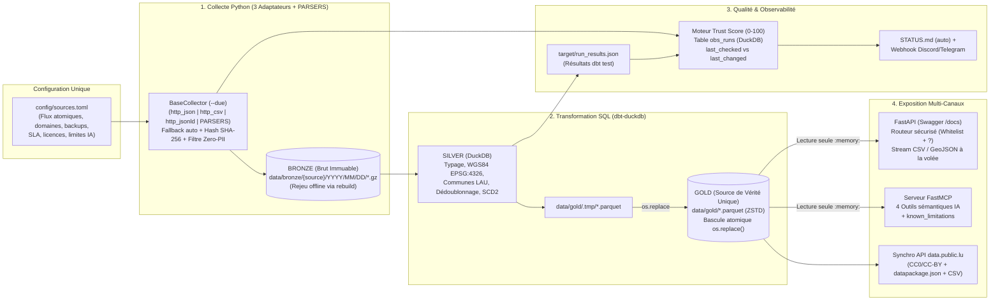

# OpenLux Hub — Architecture Technique (v1.0)

> Ce document vivant décrit l'état actuel et l'architecture cible d'OpenLux Hub.
> Il est mis à jour à chaque évolution de module, ajout de flux ou modification de schéma.

---

## 1. Vue d'Ensemble & Flux de Données



---

## 2. Découpage des Couches de Données

### 2.1 Couche Bronze (Immuable & Rejouable)
- **Format** : Fichiers bruts compressés GZIP (`.json.gz`, `.csv.gz`).
- **Chemin** : `data/bronze/{source_id}/YYYY/MM/DD/{source_id}_{timestamp_utc}_{hash8}.[json|csv].gz`.
- **Garantie** : Sanitized Zero-PII et Factual-Only appliqués en amont de l'écriture. Les payloads inchangés (`UNCHANGED`) ne créent pas de nouveau fichier physique.
- **Rejeu** : `uv run openlux rebuild` permet de reconstruire l'intégralité des couches Silver et Gold sans aucun accès internet.

### 2.2 Couche Silver (Normalisation & Typage SQL)
- **Moteur** : DuckDB via `dbt-duckdb`.
- **Modèles** :
  - `staging` : Décompression et typage à la volée (`read_json_auto`, `read_csv`).
  - `silver` : Standardisation temporelle en UTC (`TIMESTAMP`), coordonnées projetées en WGS84 (`lat`, `lon` en EPSG:4326), jointure sur le référentiel officiel des 100 communes (`commune_lau`).

### 2.3 Couche Gold (Source de Vérité Unique)
- **Format** : Uniquement fichiers Parquet compressés **ZSTD** dans `data/gold/{nom_table}.parquet`.
- **Atomicité** : Écriture systématique dans `data/gold/.tmp/{nom_table}.parquet` puis basculement instantané via `os.replace()`.
- **Isolation Lecture/Écriture** : FastAPI et FastMCP chargent les Parquet en mémoire vive (`:memory:`) ; ils ne subissent aucun verrouillage d'écriture.

---

## 3. Stack Technique Verrouillée

| Outil / Dépendance | Usage Exclusif |
| :--- | :--- |
| **Python 3.12+ & `uv`** | Environnement, `tomllib` natif, packaging et exécution CLI |
| **`httpx`** | Téléchargements HTTP, retries, `MockTransport` pour tests offline déterministes |
| **`pydantic`** | Validation du contrat `sources.toml`, modèles qualité et métadonnées API (`_meta`) |
| **`duckdb`** (+ `spatial`) | Moteur analytique in-process, calculs spatiaux, streaming CSV/GeoJSON |
| **`dbt-duckdb`** | Transformations SQL déclaratives, tests d'intégrité, génération du catalogue de données |
| **`beautifulsoup4`** | Extraction sélective des balises schema.org/Event `<script type="application/ld+json">` |
| **`fastapi` (+ `uvicorn`)** | API REST haute performance avec documentation OpenAPI / Swagger automatique |
| **`fastmcp`** | Serveur MCP (Model Context Protocol) branché sur les Parquet Gold |
| **`pytest` & `ruff`** | Tests unitaires hors-ligne, validation statique de types, lint et formatage strict |

---

## 4. Contrat de Métadonnées MLOps (`_meta`)

Chaque appel API `/v1/data/{dataset}` et chaque outil FastMCP fournit cette enveloppe standardisée :
```json
{
  "_meta": {
    "dataset": "nom_du_dataset",
    "trust_score": 95.0,
    "status": "GOOD",
    "is_stale": false,
    "last_checked_utc": "2026-11-20T22:00:00Z",
    "last_changed_utc": "2026-11-20T21:00:00Z",
    "source_used": "primary",
    "source_url": "https://...",
    "license_spdx": "CC0-1.0",
    "commercial_use_safe": true,
    "known_limitations": "Description explicite des limites du flux pour guider les agents IA.",
    "run_id": "uuid-v4",
    "pipeline_git_sha": "git-hash",
    "row_count": 100
  },
  "data": []
}
```
