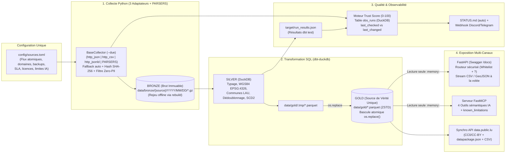

# OpenLux Hub — Architecture Technique (v1.1)

> Ce document vivant décrit l'état actuel et l'architecture cible d'OpenLux Hub.
> Il est mis à jour à chaque évolution de module, ajout de flux ou modification de schéma.

---

## 1. Vue d'Ensemble & Flux de Données



---

## 2. Découpage des Couches de Données

### 2.1 Couche Bronze (Immuable & Rejouable)
- **Format** : Fichiers bruts compressés GZIP (`.json.gz`, `.csv.gz`).
- **Chemin** : `data/bronze/{source_id}/YYYY/MM/DD/{source_id}_{timestamp_utc}_{hash8}.[json|csv].gz`.
- **Garantie** : Sanitized Zero-PII et Factual-Only appliqués en amont de l'écriture. Les payloads inchangés (`UNCHANGED`) ne créent pas de nouveau fichier physique.
- **Rejeu** : `uv run openlux rebuild` permet de reconstruire l'intégralité des couches Silver et Gold sans aucun accès internet.

### 2.2 Couche Silver (Normalisation & Typage SQL)
- **Moteur** : DuckDB via `dbt-duckdb`.
- **Modèles** :
  - `staging` : Décompression et typage à la volée (`read_json_auto`, `read_csv`).
  - `silver` : Standardisation temporelle en UTC (`TIMESTAMP`), coordonnées projetées en WGS84 (`lat`, `lon` en EPSG:4326), jointure sur le référentiel officiel des 100 communes (`commune_lau`).

### 2.3 Couche Gold (Source de Vérité Unique)
- **Format** : Uniquement fichiers Parquet compressés **ZSTD** dans `data/gold/{nom_table}.parquet`.
- **Atomicité** : Écriture systématique dans `data/gold/.tmp/{nom_table}.parquet` puis basculement instantané via `os.replace()`.
- **Isolation Lecture/Écriture** : FastAPI et FastMCP chargent les Parquet en mémoire vive (`:memory:`) ; ils ne subissent aucun verrouillage d'écriture.

---

## 3. Stack Technique Verrouillée

| Outil / Dépendance | Usage Exclusif |
| :--- | :--- |
| **Python 3.12+ & `uv`** | Environnement, `tomllib` natif, packaging et exécution CLI |
| **`httpx`** | Téléchargements HTTP, retries, `MockTransport` pour tests offline déterministes |
| **`pydantic`** | Validation du contrat `sources.toml`, modèles qualité et métadonnées API (`_meta`) |
| **`duckdb`** (+ `spatial`) | Moteur analytique in-process, calculs spatiaux, streaming CSV/GeoJSON |
| **`dbt-duckdb`** | Transformations SQL déclaratives, tests d'intégrité, génération du catalogue de données |
| **`beautifulsoup4`** | Extraction sélective des balises schema.org/Event `<script type="application/ld+json">` |
| **`fastapi` (+ `uvicorn`)** | API REST haute performance avec documentation OpenAPI / Swagger automatique |
| **`fastmcp`** | Serveur MCP (Model Context Protocol) branché sur les Parquet Gold |
| **`pytest` & `ruff`** | Tests unitaires hors-ligne, validation statique de types, lint et formatage strict |

---

## 4. Contrat de Métadonnées MLOps (`_meta`)

Chaque appel API `/v1/data/{dataset}` et chaque outil FastMCP fournit cette enveloppe standardisée (Section 5.3 du Blueprint) :
```json
{
  "_meta": {
    "dataset": "gold_weather_observations",
    "trust_score": 100.0,
    "status": "GOOD",
    "is_stale": false,
    "last_checked_utc": "2026-11-20T22:00:00Z",
    "last_changed_utc": "2026-11-20T21:00:00Z",
    "source_used": "primary",
    "source_url": "https://metapi.ana.lu/api/v1/metdata/weather",
    "license_spdx": "CC0-1.0",
    "commercial_use_safe": true,
    "known_limitations": "Couverture concentrée sur les stations principales...",
    "run_id": "uuid-v4",
    "pipeline_git_sha": "git_v1",
    "row_count": 42
  },
  "data": []
}
```

---

## 5. Modules Cœur Implémentés (Phase 2 — Exposition Universelle)

| Module | Rôle & Responsabilité Unique | Lignes |
| :--- | :--- | :---: |
| `src/openlux/config.py` | Chargement natif `tomllib` et validation Pydantic de `config/sources.toml` | 60 |
| `src/openlux/core/sanitizer.py` | Filtrage récursif Zero-PII (emails, téléphones) et garanties Factual-Only | 55 |
| `src/openlux/core/parsers.py` | Registre `PARSERS` : fonctions pures $\le 30$ lignes (`cita_datex2` DATEX II) | 47 |
| `src/openlux/core/collector.py` | Moteur de collecte unifié (3 adaptateurs + custom, fallback, SHA-256, Bronze) | 170 |
| `src/openlux/core/quality.py` | Calcul du Trust Score (0-100), traçabilité MLOps et table `obs_runs` (DuckDB) | 168 |
| `src/openlux/core/monitoring.py` | Régénération de `STATUS.md` et webhook alertes anti-spam | 97 |
| `src/openlux/core/gold.py` | Exportation atomique `.tmp` $\rightarrow$ `os.replace()`, whitelist et requêtes spatiales | 175 |
| `src/openlux/api/main.py` | API REST FastAPI : Swagger, whitelist, DuckDB in-memory, stream CSV/GeoJSON | 184 |
| `src/openlux/mcp/server.py` | Serveur FastMCP : 4 outils sémantiques IA connectés aux Data Marts Gold | 152 |
| `src/openlux/cli.py` | CLI unifiée (`openlux run`, `rebuild`, `status`, `compact`, `serve`, `mcp`) | 161 |
| **Total Cœur Python** | **Budget strict $< 1\,500$ lignes (cible $< 1\,200$)** | **1 277** |

---

## 6. Canaux d'Exposition (Détails)

### 6.1 API REST FastAPI (`openlux serve`)
- `GET /v1/status` : Santé globale, Trust Scores et horodatages récents.
- `GET /v1/datasets` : Catalogue dynamique (descriptions, limites, licence, colonnes, volume).
- `GET /v1/data/{dataset}` : Filtrage paramétré `?` (commune, date_from, date_to, lat, lon, radius_km, limit, offset) et bloc `_meta`. Rejet 404 strict des injections SQL et traversals.
- `GET /v1/exports/{dataset}.parquet` : Téléchargement direct du fichier Parquet ZSTD officiel.
- `GET /v1/exports/{dataset}.csv` : Streaming à la volée depuis DuckDB in-memory (zéro duplication disque).
- `GET /v1/exports/{dataset}.geojson` : Streaming GeoJSON `FeatureCollection` à la volée.
- `GET /docs` & `/redoc` : Documentation OpenAPI 3.1 auto-générée.

### 6.2 Serveur FastMCP (`openlux mcp`)
- `get_platform_health(domain: str | None)` : État de fraîcheur et anomalies par source/domaine.
- `get_luxembourg_day_context(date: str, commune: str)` : Vue journalière croisée (météo, jours fériés, trafic autoroutier).
- `search_luxembourg_events_and_works(...)` : Recherche textuelle et géospatiale croisée (chantiers, perturbations autoroutières).
- `query_dataset(dataset: str, commune: str | None, limit: int)` : Accès direct structuré et sécurisé aux tables Gold autorisées.
