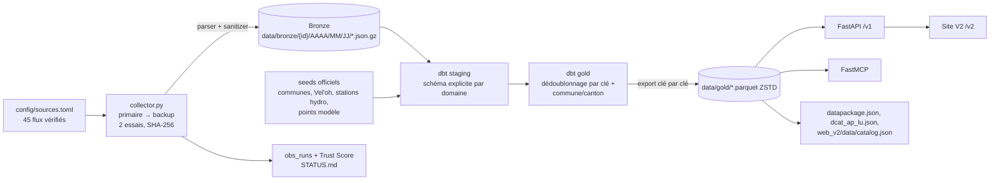

# OpenLux Hub — Architecture technique (v3, « données fiables »)

> Document vivant : il décrit l'état réel du dépôt. Toute évolution de module, de flux ou de table
> Gold le met à jour dans le même lot. Décisions structurantes : [ADR-006](adr/006-refonte-v3-donnees-fiables.md).

## 1. Principe directeur

**Aucune donnée inventée.** Une source qui échoue produit 0 ligne et un statut `ERROR` ; elle n'est
jamais remplacée par une fixture, une valeur par défaut ou une date codée en dur. Chaque ligne Gold
porte sa `source_id` et son `collected_at_utc` (horodatage réel de collecte). La nature de chaque
source est déclarée (`data_origin` : `official`, `model`, `community`, `press`).

## 2. Flux de données

## 3. Couches

| Couche | Emplacement | Règle |
| :--- | :--- | :--- |
| Bronze | `data/bronze/{source_id}/…/*.json.gz` (non versionné) | Sortie du parser, sanitisée (Zero-PII, Factual-Only). Un payload identique (`UNCHANGED`) n'écrit rien. Une source jamais collectée reçoit `empty.json.gz` = `[]` (0 ligne). |
| Staging | `dbt_project/models/staging/stg_<domaine>.sql` (vues) | Union des sources d'un domaine via la macro `bronze(source_id, columns)` : schéma explicite, `collected_at_utc` extrait du nom d'archive. |
| Gold | `dbt_project/models/gold/gold_<domaine>.sql` (tables) | Horodatages en UTC, rattachement commune/canton (`with_commune`), dernière version par clé métier. |
| Parquet | `data/gold/*.parquet` (versionné) | `core/gold.py` fusionne l'historique Parquet et la table du run : pour chaque clé de `GOLD_KEYS`, la version au `collected_at_utc` le plus récent ; aucune clé passée n'est supprimée. Écriture dans `.tmp/` puis `os.replace()`. |

dbt s'exécute **depuis `dbt_project/`** (`cwd`), car dbt-duckdb résout `seeds/` et `../data/` depuis le
répertoire courant. Exécuté depuis la racine, `dbt seed` échouait sans bruit (régression corrigée en v3).

### Rattachement territorial

`with_commune(rel)` associe chaque point (lat, lon) à la commune dont le centroïde officiel est le plus
proche, si elle est à 8 km ou moins ; sinon `NULL` (point hors Luxembourg). Le seed `ref_communes_lu.csv`
est régénéré par `scripts/build_reference_seeds.py` depuis les limites administratives officielles
(CC0, 100 communes, 12 cantons). Les points modèle Open-Meteo sont rattachés au chef-lieu demandé
(`ref_model_points.csv`) ; la maille réelle reste dans `grid_lat` et `grid_lon`.

## 4. Modules Python (`src/openlux/`)

| Module | Rôle |
| :--- | :--- |
| `config.py` | Modèle Pydantic du registre (`parser` obligatoire, `parser` propre au backup, `data_origin`). |
| `core/collector.py` | Collecte primaire → backup, 2 essais, jetons d'URL (`{today}`, `{last_year}`…), sanitisation, Bronze. |
| `core/parsers.py` | Helpers (`_utc`, `_f`, `_x`) + DATEX II (CITA v2/v3, Bison Futé), Autobahn, infos trafic VdL. |
| `core/parsers_transit.py` | SNCF SIRI SX, SNCB iRail, messages bus VdL. |
| `core/parsers_env.py` | Open-Meteo (météo, air, pollen), MeteoLux Findel, niveaux d'eau AGE, baignade, prix spot. |
| `core/parsers_city.py` | Vel'oh (JCDecaux v3, GBFS), parkings VdL, Chargy KML, OpenSky, chantiers VdL. |
| `core/parsers_civic.py` | Fériés LU et OpenHolidays, MeteoAlarm, pétitions CHD, ADEM, LUSTAT SDMX, carburants. |
| `core/parsers_files.py` | XLSX (stdlib), GML INSPIRE (inverse LAEA EPSG:3035 → WGS84), Overpass, mymaps. |
| `core/parsers_culture.py` | echo.lu, agenda VdL, Rockhal, RSS grèves. |
| `core/gold.py` | Export Parquet par clé (`GOLD_KEYS`), registre des tables. |
| `core/gold_query.py` | Lecture paramétrée (`?`), filtre rayon (haversine SQL), streaming CSV et GeoJSON, métadonnées mesurées. |
| `core/quality.py` / `core/monitoring.py` | Trust Score (un échec de collecte vaut toujours `ERROR`), `obs_runs`, `STATUS.md`, `/v1/status`. |
| `publish/opendata_lu.py`, `publish/tables.py` | Catalogue mesuré (volumes, couverture, sources, licences) → API, site, Data Package, DCAT-AP-LU. |
| `api/main.py`, `mcp/server.py` | REST (`/v1/datasets`, `/v1/data`, `/v1/exports`, `/v1/status`) et 4 outils MCP. |

## 5. Tables Gold (24)

Environnement : `gold_weather_observations`, `gold_air_quality` (+ pollens), `gold_water_levels`,
`gold_bathing_water`, `gold_weather_warnings`. Mobilité : `gold_traffic_events` (LU, FR, DE),
`gold_roadworks`, `gold_transit_disruptions`, `gold_mobility_veloh`, `gold_mobility_parkings`,
`gold_chargy_stations`, `gold_aviation`. Économie : `gold_fuel_prices`, `gold_inflation`,
`gold_electricity_spot`, `gold_unemployment`. Logement : `gold_building_permits`, `gold_housing_prices`.
Calendrier : `gold_holidays`. Territoire : `gold_equipment`. Vie civique : `gold_petitions`.
Culture : `gold_culture_events`. Actualité : `gold_strikes_news`. Synthèse : `gold_luxembourg_daily_context`
(jour × canton).

Détail des sources, licences et limites : [DATA_CATALOG.md](DATA_CATALOG.md) et
[rapport de vérification des sources](sources/Sources%20ouvertes%20Luxembourg%20vérifiées.md).

**Domaines retirés faute de source réelle vérifiée** : radioactivité (EURDEP exige une authentification),
bruit (couches cartographiques sans série), trafic wallon (identifiants requis), ouvertures
dominicales, visitluxembourg, Luxexpo, Stade et Coque (aucune donnée structurée), annonces immobilières
aspirées sur athome.lu (instantané figé d'un site commercial).

## 6. Qualité

- `pytest` (73 tests, 100 % hors ligne) sur de **vraies réponses réduites** (`tests/fixtures/`, capturées le 24/11/2026).
- `dbt test` : unicité des clés Gold, absence d'e-mail ou de téléphone dans les textes, points rattachés à un canton situés dans l'emprise du Luxembourg.
- Trust Score = 0,35 × fraîcheur + 0,25 × complétude (`min_rows`) + 0,20 × validité dbt + 0,20 × source (backup 80) ; échec de collecte ⇒ `ERROR` (< 60).

## 7. Exposition

- `openlux serve` : `/` redirige vers `/v2/` (le portail V1 à catalogue codé en dur a été retiré).
- Le site V2 lit `/v1/datasets` et `/v1/status`, sinon l'instantané `web_v2/data/catalog.json` régénéré à chaque `openlux run`. Aucun chiffre n'est écrit à la main.
- GitHub Actions (`data_pipeline.yml`, toutes les 30 min) : `openlux run`, puis commit de `data/gold`, `STATUS.md` et `web_v2/data/catalog.json`.
